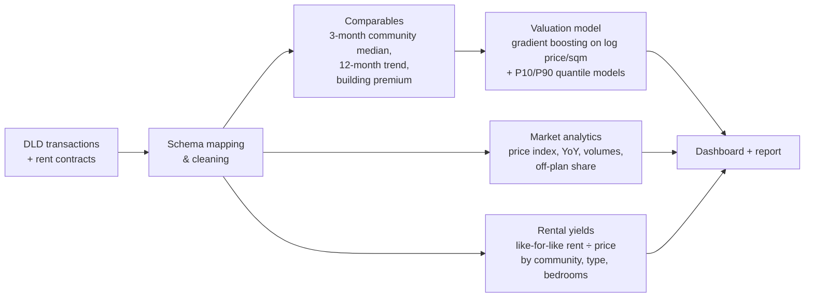

# 🏙️ Dubai Property Analytics

**Market trends, a fair-value estimator and rental-yield analysis for Dubai homes, built for
Dubai Land Department (DLD) open data.** Load the official transaction and rent-contract files and get a
community price index, an automated valuation model with a fair price range, and an investor view
of rental yield vs. capital growth.

> Runs on **real DLD open data** once you download it (see below). Without it, the project generates a
> sample in the same schema so everything works out of the box; the results below are from that sample
> and are illustrative, not official market figures.

---

## What it answers

| Question | Who asks it | Output |
|---|---|---|
| How are prices moving in each community? | Developers, brokers, investors | Monthly price index, YoY change, volumes, off-plan share |
| What is this home worth? Is the asking price fair? | Buyers, banks, brokers | Fair value with a P10–P90 range and an over/under-priced verdict |
| Where are the best rental yields, and where is growth? | Investors, portfolio managers | Like-for-like gross yield by community and an investor matrix |

## Results (sample data, 60,000 sales and 40,000 rent contracts, Jan 2024 – Jun 2026)

**Valuation model**, tested out-of-time on the last 3 months (5,846 sales it never saw):

| Metric | Model | Community-median baseline |
|---|---|---|
| Median error | **7.0%** | 9.8% |
| Valued within 10% of the sale price | **67%** | 51% |
| Within 20% | 96% | |
| Sale price inside the P10–P90 range | 75% | |

The biggest gain comes from a **building-level premium**: how a project's past sales priced against its
community. In Dubai, the specific building (developer, view, age) is one of the strongest price drivers.

**Example:** 1-bedroom, 75 sqm in Dubai Marina, ready, near the metro, listed at AED 1.95M →
fair value AED 1.55M (range 1.34M–1.84M) → *above fair range, negotiate*.

**Investor view:** communities are grouped into *high yield + strong growth*, *income plays*, *growth plays*
and *mature/prime*. In the sample, JVC, JLT, Dubai South and Sports City land in the first group,
Palm Jumeirah and Dubai Hills are growth plays, and Downtown and DIFC are mature prime markets with lower yields.

---

## Using real DLD data

1. Download residential **Transactions** (and optionally **Rents**) as CSV from the DLD open data page:
   https://dubailand.gov.ae/en/open-data/real-estate-data, or request the `dld_transactions-open` and
   `dld_rent_contracts-open` datasets on Dubai Pulse (https://www.dubaipulse.gov.ae; access by API key).
2. Save them as `data/raw/transactions.csv` and `data/raw/rent_contracts.csv`.
3. Run `make pipeline`. The report states which source was used.

Column names differ slightly between sources, so `src/dubaiprop/load.py` maps each field from a list of
aliases (e.g. `actual_worth` / `Amount`, `procedure_area` / `Property Size (sq.m)`). If a file uses a name
that isn't listed, the error message prints the file's columns so you can add it in one line.
Note that DLD uses official community names (e.g. *Marsa Dubai* for Dubai Marina).

**Cleaning applied:** sales only, residential only, removes nominal transfers (< AED 100K), missing or
implausible sizes, and the extreme 0.5% price-per-sqm tails per community.

---

## How it works



| Component | Where |
|---|---|
| Schema mapping and cleaning for DLD files | `src/dubaiprop/load.py` |
| Sample data in DLD schema | `src/dubaiprop/sample.py` |
| Valuation model, comparables, backtest | `src/dubaiprop/valuation.py` |
| Price index, yields, investor matrix | `src/dubaiprop/market.py` |
| End-to-end run and report | `src/dubaiprop/pipeline.py` |
| Market / valuation / investor dashboard | `dashboard.py` |

## Quick start

```bash
git clone https://github.com/vineethasusan/dubai-property-analytics.git
cd dubai-property-analytics
python -m venv .venv && source .venv/bin/activate
make install
make pipeline     # uses data/raw/*.csv if present, otherwise the sample -> outputs/report.md
make dashboard    # http://localhost:8501
```

## Design decisions

- **Out-of-time testing.** A valuation model is used on future sales, so it is tested on the most recent months only.
- **Comparables without look-ahead.** Community and building signals are built only from earlier months (tested).
- **A range, not a single number.** Buyers and lenders need to know how confident the estimate is.
- **Like-for-like yields.** Rent and price are matched by community, property type and bedrooms, so a community
  full of studios isn't compared with one full of villas.
- **Built for messy registry data.** Flexible column mapping, explicit cleaning rules, and a data-quality report.

## Roadmap

- Geocoding and distance features (metro, beach, schools) from community centroids
- Off-plan premium tracking by developer and handover year
- Forecast community price index 6–12 months ahead
- LLM assistant answering "what did 2-bed flats in JLT sell for last quarter?" over the cleaned data

## Author

**Vineetha Susan Alexander** · Senior Data Scientist & AI Consultant, Dubai
[LinkedIn](https://www.linkedin.com/in/vineetha-susan-alexander-465997135) · [GitHub](https://github.com/vineethasusan)

MIT License.
